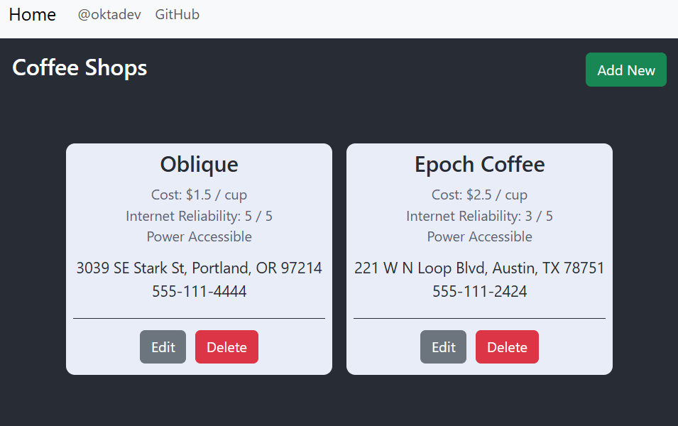

# Spring Boot + ReactJS Application Built Using Build-Convention

This web application manages a list of coffee shops.



The project is fully built using **JeKa**, leveraging a [convention](https://github.com/jeka-dev/demo-build-conventions/blob/master/jeka-src/dev/jeka/demo/conventions/springboot/reactjs/Convention.java) that defines the build logic.

This build-convention is designed for building **Spring Boot** projects with an optional **ReactJS** frontend. It automates tasks such as:

- Running Java tests with code coverage,
- Building and testing the ReactJS app,
- Performing **SonarQube** analysis (Java and JS),
- Creating Docker and native images.

End-to-end tests are located in the `e2e` package under the `src/test/java` directory. 
The end-2-end test handles deployment and un-deployment of the application using containers.

<small><i>Configured via <code>jeka.properties</code></i></small>
```properties
jeka.version=0.11.69
jeka.java.version=25
jeka.kbean.default=project

# Use a build convention defined at https://github.com/jeka-dev/demo-build-conventions
jeka.classpath=dev.jeka:convention-examples:0.11.39-2
@convention=on
```

The dependencies are declared in [jeka.project.deps](jeka.project.deps).

## Prerequisites

- [JeKa installed](https://jeka-dev.github.io/jeka/installation/). JeKa downloads the JDK and Node.js it needs.
- Google Chrome, for the end-to-end tests.
- Docker, for the Docker images.
- A SonarQube server, only for `jeka build`.

## How to Use

### Setup IDE
 
```shell
jeka intellij: sync
```

### Build

Help on convention KBean:
```shell
jeka convention: --doc
```

Run a full build, including SonarQube analysis and end-to-end tests (needs a SonarQube server)
```shell
jeka build
```

Run a full build, excluding the SonarQube analysis
```shell
jeka test pack e2eTest
```

Run the bootable jar, then open http://localhost:8080:
```shell
jeka runJar
```

Create a Docker image:
```shell
jeka docker: build
```

Create a Spring-Boot native Docker image:
```shell
jeka docker: buildNative
```

## Links

- [Reuse build conventions: the convention repository](https://github.com/jeka-dev/demo-build-conventions)
- [KBeans](https://jeka-dev.github.io/jeka/reference/kbeans/)
- [Spring Boot plugin](https://github.com/jeka-dev/jeka/tree/master/plugins/plugins.springboot)
